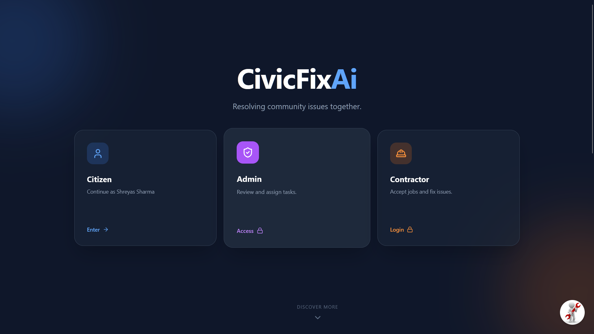
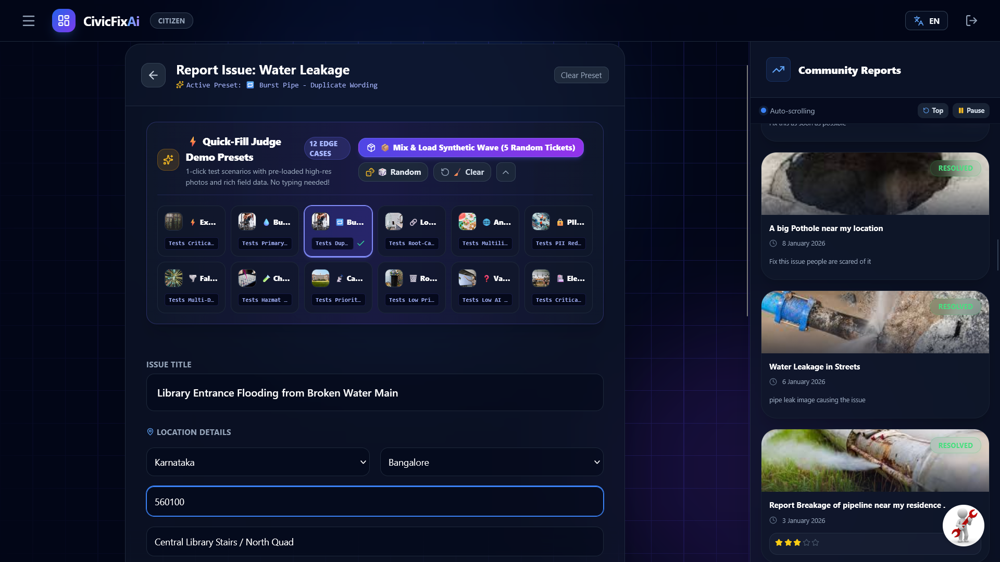
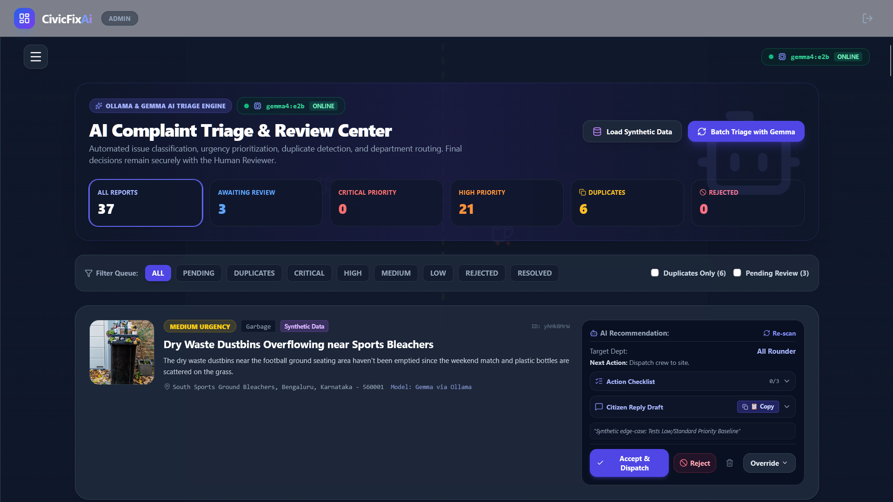
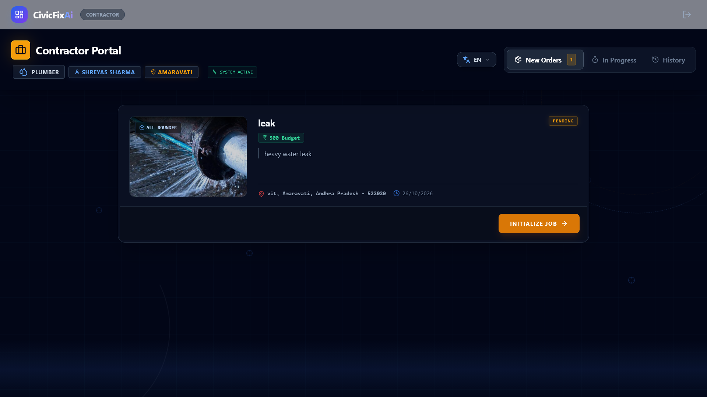
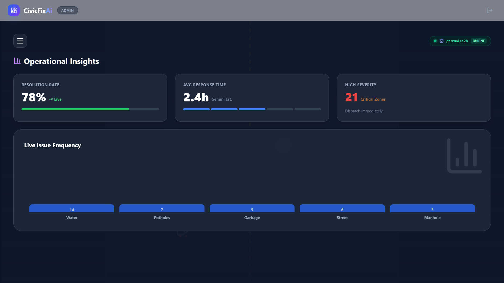
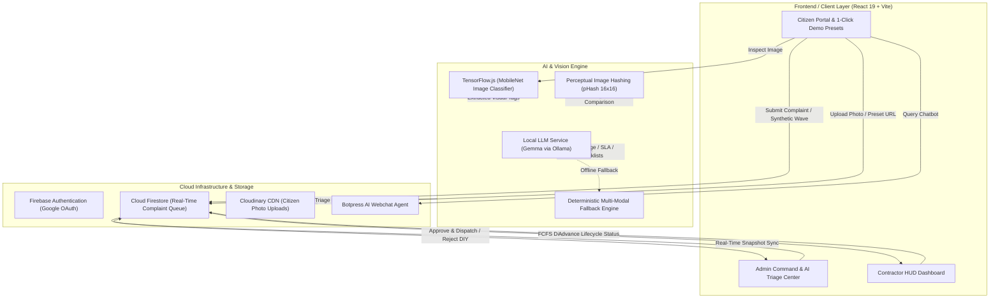

# 🏙️ CivicFix AI — AI-Powered Civic & Campus Grievance Triage Platform

[](https://civic-fix-ai-lac.vercel.app/)
[](https://github.com/omshree59/CivicFix-AI)
[](https://vitejs.dev/)
[](https://react.dev/)
[](https://firebase.google.com/)
[](https://www.tensorflow.org/js)
[](https://ollama.com/)

> **CivicFix AI** is a full-stack, intelligent municipal and campus grievance resolution platform. It ingests public service complaints, automatically classifies issues and hazards, computes urgency scores and SLA turnaround estimates, detects duplicate or clustered incidents using perceptual visual hashing, generates 3-step action checklists and pre-drafted citizen notifications, and routes tasks to specialized trade contractors—all while keeping final dispatch authority strictly with human reviewers.

---

## 📌 Live Demo & Screenshots

🔗 **Live Production URL:** [https://civic-fix-ai-lac.vercel.app/](https://civic-fix-ai-lac.vercel.app/)  
📁 **GitHub Repository:** [https://github.com/omshree59/CivicFix-AI](https://github.com/omshree59/CivicFix-AI)

### 1. Unified Portal Gateway & Role Selector
Interactive entrance offering role-tailored workflows for Citizens, Contractor Specialists, and Municipal Administrators with a dynamic 3D WebGL background.


### 2. Citizen Complaint Form & 1-Click Judge Demo Presets
Citizen submission interface featuring the collapsible **⚡ Quick-Fill Judge Demo Presets** bar, pre-loaded high-resolution photos, and one-click synthetic batch wave injection.


### 3. AI Complaint Triage & Review Center
Administrative command cockpit displaying automated urgency triage, 100% verified duplicate detection, SLA estimation, **3-Step Action Checklists**, and **Auto-Drafted Citizen Replies** with one-click clipboard copy.


### 4. Contractor Operations Command (HUD)
Specialized contractor operations cockpit with trade-based job claiming (First-Come, First-Served), real-time status progression, and earnings computation in Indian Rupees (₹).


### 5. Municipal Operational Analytics
Real-time infrastructure analytics tracking resolution velocity, category distributions, and critical zone density.


---

## 🎯 Problem Statement

Public municipal agencies, university campuses, and residential infrastructure managers receive massive volumes of unstructured service requests daily. Key operational bottlenecks include:

* **Triage Fatigue:** High-priority life-safety emergencies (snapped sparking live wires, open drainage pits, chemical leaks) are frequently buried beneath routine requests (overflowing trash cans).
* **Duplicate Floods:** A single visible incident (such as a burst main water line) generates dozens of duplicate reports from different citizens, clogging call lines and dispatch queues.
* **Misrouted Dispatches:** Non-technical citizen descriptions often result in the wrong department or contractor being deployed, driving up labour costs and SLA delays.
* **Lack of Actionable Review Tools:** Reviewers lack structured execution checklists and pre-written updates, leading to inconsistent communication and delayed citizen feedback.

**CivicFix AI** addresses these challenges through a hybrid multi-modal AI pipeline combining computer vision, local/cloud LLMs, perceptual image hashing, and decision-support heuristics—maintaining strict human oversight over financial and physical dispatches.

---

## ✨ Key Features

### 🧑‍🤝‍🧑 Citizen Portal
* **⚡ 1-Click Judge Demo Presets:** 12 curated edge-case complaints (electrical hazards, burst water mains, semantic duplicates, PII redaction, Hinglish rants, hazmat fumes, elevator entrapment) pre-loaded with high-definition photos and verified Indian geolocation data.
* **📦 Mix & Load Synthetic Wave:** One-click `[ 📦 Mix & Load Synthetic Wave (5 Random Tickets) ]` button injects diverse test tickets into Cloud Firestore in real time, immediately triggering live duplicate/cluster detection and urgency sorting.
* **Instant Multi-Modal Analysis:** Citizens can upload a photo and draft an issue title/description, triggering real-time classification, severity scoring, and safety precautions via TensorFlow.js MobileNet and Gemma.
* **Live Incident Tracking & My Reports:** Monitor complaint lifecycles in real time (`OPEN` → `Accepted` → `In Progress` → `Resolved`).
* **Continuous Auto-Scrolling Community Feed:** Live public incident feed that smoothly scrolls and automatically restarts from the top once it reaches the end.
* **Interactive AI Chatbot:** Embedded Botpress conversational agent for community assistance.
* **Multilingual UI:** Complete English and Hindi language localization via `i18next`.

### 👮 Administrator & AI Triage Center
* **Deep Urgency & SLA Scoring:** Complaints are prioritized into `Critical`, `High`, `Medium`, and `Low` urgency tiers with estimated resolution windows (e.g., 2–4 hours for live wires, 24–48 hours for potholes).
* **Perceptual Visual Duplicate Detection (pHash):** 16×16 grayscale canvas hashing and Hamming distance analysis prevent false duplicate merges (e.g., two distinct potholes on different streets are recognized as separate tickets, while identical burst pipe photos are clustered with 100% confidence).
* **3-Step Action Checklists:** Interactive checkboxes tailored to each category (e.g., *[ ] De-energize main breaker, [ ] Barricade 10m perimeter, [ ] Dispatch electrician*).
* **Auto-Drafted Citizen Replies:** Pre-written messages referencing incident location, assigned department, and duplicate merge context, complete with a `[ 📋 Copy Reply ]` button.
* **Public DIY Rejection Guardrail:** Low-severity tickets that fall below contractor labour thresholds can be safely marked as Public DIY with instructional guidance.
* **Real-Time Model Detection:** Dynamic model status modal (`OllamaModelStatus`) that probes local Ollama instances and falls back to deterministic heuristic triage when offline.

### 👷 Contractor Operations Portal
* **Trade-Specific Access:** Dedicated PIN-protected logins for Electricians (`1111`), Plumbers (`2222`), Waste Management (`3333`), Road Works (`4444`), and All-Rounders (`5555`), plus Master PIN (`2025`).
* **First-Come, First-Served (FCFS) Claiming:** Contractors claim open dispatches within their operating city and trade license.
* **Financial Compensation Tracking:** Calculates accumulated earnings in Indian Rupees (₹) upon task completion.

---

## ⚡ 12 Comprehensive Judge Demo Presets

All 12 presets are available directly from the **⚡ Quick-Fill Judge Demo Presets** bar in the Citizen Complaint Form:

| # | Preset | Edge Case Tested | Department | Default Urgency | Location |
|---|---|---|---|---|---|
| 1 | **⚡ Exposed Live Wire** | `[Critical Urgency & Safety]` | Electrician | **Critical** | Outside Hostel Block B Main Gate, Bangalore |
| 2 | **💧 Burst Pipe - Original** | `[Primary Ticket Creation]` | Plumber | **High** | North Academic Quad, Near Library, Bangalore |
| 3 | **🔁 Burst Pipe - Duplicate** | `[Semantic & Visual Duplicate]` | Plumber | **High** | Central Library Stairs / North Quad, Bangalore |
| 4 | **🔗 Low Water Pressure** | `[Root-Cause Clustering]` | Plumber | **Medium** | Canteen & Lab Complex, Bangalore |
| 5 | **🌐 Angry Hinglish Rant** | `[Multilingual NLP & Sentiment]` | Plumber | **Medium** | Hostel Block D, 3rd Floor, New Delhi |
| 6 | **🔒 PII-Heavy Complaint** | `[PII Privacy Auto-Redaction]` | Plumber | **High** | Staff Quarters, Flat 402, Mumbai |
| 7 | **🌪️ Fallen Tree on Road** | `[Multi-Dept Domino Routing]` | Road Works | **Critical** | Main Campus Ring Road near Gate 2, Bangalore |
| 8 | **🧪 Chemical Fume Leak** | `[Hazmat Escalation SOP]` | All Rounder | **Critical** | Science Building, Basement Room 04, Pune |
| 9 | **📡 Campus Wi-Fi Outage** | `[Context-Aware Exam Priority]` | All Rounder | **Critical** | Examination Hall 3 & Computer Center, New Delhi |
| 10 | **🗑️ Routine Overflowing Bin** | `[Low Priority Baseline]` | Sanitation | **Low** | South Sports Ground Bleachers, Bangalore |
| 11 | **❓ Vague / Frustrated Rant** | `[Low Confidence Guardrail]` | All Rounder | **Low** | Campus Central Plaza, Bangalore |
| 12 | **🏥 Elevator Trap Emergency** | `[Life-Safety Instant Human Alert]` | Electrician | **Critical** | Admin Tower, Lift #2 Shaft, Mumbai |

> [!TIP]
> **Burst Pipe #2 and #3 share the exact same image URL.** When injected or tested, the perceptual hash detector achieves a **100% duplicate visual match**, clustering them together in the Admin Triage Center!

---

## 🏗️ System Architecture



---

## 🛠️ Technology Stack

| Layer | Technologies |
| :--- | :--- |
| **Frontend Framework** | React 19.x, Vite 7.x |
| **Styling & Animation** | Tailwind CSS 3.x, Framer Motion 12.x, OGL (3D Canvas Splash) |
| **Icons & Visuals** | Lucide React |
| **Maps & Geospatial** | Leaflet 1.9, React-Leaflet 5.0 |
| **Internationalization**| i18next, react-i18next (English & Hindi) |
| **Database & Auth** | Google Firebase (Cloud Firestore, Firebase Authentication) |
| **Image Hosting** | Cloudinary API |
| **Client-Side Vision** | TensorFlow.js 4.x (`@tensorflow/tfjs`), MobileNet v2 (`@tensorflow-models/mobilenet`) |
| **Perceptual Hashing** | Custom Canvas-based 16×16 Grayscale pHash with Hamming Distance |
| **Language Model** | Google Gemma (Gemma, Gemma 2, Gemma:2b, Gemma:7b) via Ollama |
| **Local Proxy** | Vite Proxy (`/api/ollama` → `http://127.0.0.1:11434`) |
| **Chatbot Support** | Botpress Webchat |

---

## 📂 Project Structure

```text
civic-fix-ai/
├── docs/
│   └── screenshots/              # High-resolution application screenshots
│       ├── 01_landing_hero.png
│       ├── 02_citizen_presets_form.png
│       ├── 03_ai_triage_center.png
│       ├── 04_contractor_hud.png
│       └── 05_admin_analytics.png
├── public/                       # Static public assets
├── src/
│   ├── assets/                   # Vector and graphic assets
│   ├── components/
│   │   ├── AdminDashboard.jsx    # Admin command center, analytics, and settings
│   │   ├── AiChatbot.jsx         # Botpress conversational assistant integration
│   │   ├── AiTriageCenter.tsx    # AI recommendation center, checklists & draft replies
│   │   ├── AutoScrollCommunityFeed.tsx # Real-time public incident ticker with loop restart
│   │   ├── ContractorDashboard.jsx # Contractor HUD, job claiming & earnings tracker
│   │   ├── DuplicateDetectionBadge.tsx # Visual match & duplicate indicator badge
│   │   ├── ForecastModal.jsx     # Predictive maintenance model dialog
│   │   ├── IssueCard.jsx         # Individual complaint card component
│   │   ├── IssueDetailModal.jsx  # Detailed complaint view with action checklist
│   │   ├── IssueMap.jsx          # Leaflet geospatial issue map
│   │   ├── LandingPage.jsx       # 3D animated splash screen & role gateway
│   │   ├── LiveTrackerModal.jsx  # Real-time incident progress timeline
│   │   ├── OllamaModelStatus.tsx # Ollama connection monitor & model switcher
│   │   ├── RejectReasonModal.tsx # Public DIY triage and rejection modal
│   │   ├── ReportForm.jsx        # Citizen reporting form with 1-click presets & wave loader
│   │   ├── SyntheticDataModal.tsx# Synthetic campus data injection modal
│   │   └── UserProfileModal.jsx  # Citizen account profile dialog
│   ├── data/
│   │   ├── demoPresets.ts        # 12 Judge Demo Presets and synthetic wave generator
│   │   └── locations.js          # Indian states, cities, and pincode datasets
│   ├── services/
│   │   ├── aiService.js          # Multi-modal pipeline (MobileNet + Gemma hybrid)
│   │   ├── imageHashService.ts   # Perceptual hash algorithm (100% duplicate check)
│   │   └── ollamaService.ts      # Gemma prompts, Ollama client, heuristic triage
│   ├── App.css
│   ├── App.jsx                   # Main layout routing, state, and Firebase snapshot
│   ├── firebase.js               # Firebase client initialization
│   ├── i18n.js                   # English and Hindi localization dictionary
│   ├── index.css                 # Tailwind directives and custom scrollbars
│   └── main.jsx                  # React application entry point
├── .env.example                  # Environment variable template
├── index.html                    # Application HTML template
├── package.json                  # Dependencies and scripts manifest
├── tailwind.config.js            # Tailwind theme and plugin definitions
└── vite.config.js                # Vite configuration with Ollama API proxy
```

---

## ⚡ Getting Started

### Prerequisites

Ensure you have the following installed:
* **Node.js** (v18.x, v20.x, or v22.x+ recommended)
* **npm** (v9.x or later)
* *(Optional for local LLM)* **[Ollama](https://ollama.com/)** running locally (`ollama run gemma:2b`)

### Installation

1. **Clone the repository:**
   ```bash
   git clone https://github.com/omshree59/CivicFix-AI.git
   cd CivicFix-AI
   ```

2. **Install dependencies:**
   ```bash
   npm install
   ```

3. **Configure Environment Variables:**
   Create a `.env` file in the root directory (see [Environment Variables](#-environment-variables-and-configuration) below for details).

4. **Start the local development server:**
   ```bash
   npm run dev
   ```
   Open [http://localhost:5173](http://localhost:5173) in your browser.

5. **Build for production:**
   ```bash
   npm run build
   npm run preview
   ```

---

## 🔐 Environment Variables and Configuration

Create a `.env` file in the root directory. Use the template below:

```env
# Firebase Configuration
VITE_FIREBASE_API_KEY=your_firebase_api_key_here
VITE_FIREBASE_AUTH_DOMAIN=your_project.firebaseapp.com
VITE_FIREBASE_PROJECT_ID=your_project_id
VITE_FIREBASE_STORAGE_BUCKET=your_project.appspot.com
VITE_FIREBASE_MESSAGING_SENDER_ID=your_messaging_sender_id
VITE_FIREBASE_APP_ID=your_app_id
VITE_FIREBASE_MEASUREMENT_ID=your_measurement_id

# Google Gemini API Key (Optional cloud backup)
VITE_GEMINI_API_KEY=your_gemini_api_key_here

# Access PINs for Hackathon / Evaluation Mode (Optional overrides)
VITE_ADMIN_PIN=1269
VITE_CONTRACTOR_MASTER_PIN=2025
```

> [!NOTE]
> If you run the project without a local Ollama instance or external Gemini key, the application automatically uses its built-in **Deterministic Multi-Modal Heuristic Engine**, ensuring 100% of the UI, triage cards, duplicate checks, and action checklists function without failure.

---

## 🧠 AI Implementation & Decision Logic

### 1. Multi-Modal Vision Analysis (TensorFlow.js)
When an image is uploaded or loaded from presets, `loadImageForAI` feeds the image tensor to MobileNet. Extracted visual classifications (e.g., `water`, `pavement`, `wire`, `ashcan`) enrich the complaint text before LLM analysis.

### 2. Gemma Triage via Ollama
The prompt instructs Gemma to act as an automated civic triage officer. Gemma returns structured JSON with:
* **Identified Issue:** Concise summary of the core incident.
* **Urgency & Score:** `Critical` (90–100), `High` (75–89), `Medium` (50–74), or `Low` (1–49).
* **Routing Department:** `Electrician`, `Plumber`, `Road Maintenance`, `Garbage Collector`, or `All Rounder`.
* **Action Checklist:** 3 immediate sequential steps for field crews.
* **Citizen Reply Draft:** Pre-composed, professional notification detailing current status and duplicate merge notes.

### 3. Strict 100% Visual Duplicate Detection (pHash)
To prevent false-positive duplicate mergers (such as merging two separate road potholes located miles apart), `imageHashService.ts` computes a 256-bit perceptual hash:
1. Resizes the image to a 16×16 grayscale grid on an off-screen HTML5 Canvas.
2. Computes the mean luminance.
3. Generates a 256-character binary string (`1` for above average, `0` for below average).
4. Calculates Hamming distance across loaded tickets. Images match only if visual distance is within strict similarity thresholds (Hamming distance ≤ 8).

---

## 🛡️ Data, Privacy & Human Oversight

* **Synthetic Data Generation:** Includes built-in generators (`SyntheticDataModal` and `demoPresets.ts`) that simulate campus and municipal complaints with anonymized reporter names.
* **PII Redaction Testing:** Dedicated test preset demonstrates automated stripping of phone numbers, employee IDs, and email addresses from public display fields.
* **Human-in-the-Loop Authority:** The AI engine **only recommends** actions, budgets, and routing. Dispatches require explicit reviewer confirmation (`Accept & Dispatch`), preventing automated over-allocation of funds or erroneous contractor assignments.
* **Public DIY Separation:** Non-critical issues rejected for contractor dispatch are diverted to a public self-service guide and hidden from municipal contractor payout queues.

---

## 🧭 Evaluation Access & Demo Credentials

For hackathon judges and evaluators testing the platform:

| Role | Access Method | Credentials / PIN | Direct Shortcut |
| :--- | :--- | :--- | :--- |
| **Citizen Portal** | Click "Citizen Portal" | Google Sign-In or Cached Demo User | Auto-fills with presets |
| **Judge Presets** | Click any preset pill | Auto-fills title, description & photo | 12 Edge Cases Available |
| **Synthetic Wave** | Click `[ 📦 Mix & Load Synthetic Wave ]` | Injects 5 diverse tickets to Firestore | Instant real-time clustering |
| **Contractor Portal** | Master Access | Master PIN: `2025` | Claims jobs & tracks earnings |
| *Trade PINs* | Select Specific Trade | Electrician (`1111`), Plumber (`2222`), Cleaner (`3333`), Road (`4444`), All-Rounder (`5555`) | Filtered by trade license |
| **Admin Command** | Click "Admin / Authority" | Admin PIN: `1269` | Full triage, checklists & replies |
| **Analytics Tab** | Admin Dashboard | Click "Analytics" tab | Resolution velocity & zones |

---

## 🚀 Deployment

The project is configured for continuous deployment on **Vercel**:
* **Build Command:** `npm run build`
* **Output Directory:** `dist`
* **SPA Routing:** Configured for single-page client routing via `vercel.json` / Vite.
* **Vite Proxy:** Local dev server proxies `/api/ollama` to `http://127.0.0.1:11434`. In cloud production, the application transparently leverages cloud AI services or the client-side heuristic engine.

---

## 🔮 Future Improvements

1. **WebGPU On-Device LLM:** Implement WebLLM / Wasm to execute quantized Gemma models directly in the browser with zero server latency.
2. **Geospatial Hotspot Heatmaps:** Cluster real-time incident reports onto Leaflet heatmaps using DBSCAN spatial clustering.
3. **Voice Grievance Ingestion:** Support multi-lingual audio reporting for citizens via the Web Speech API.
4. **Municipal ERP Webhooks:** Automated integration adapters for SAP Public Sector and municipal work-order systems.

---

## 🤝 Contributing

Contributions are welcome! Please follow these steps:
1. Fork the repository.
2. Create a feature branch: `git checkout -b feature/your-feature-name`.
3. Commit your changes: `git commit -m "Add descriptive commit message"`.
4. Push to the branch: `git push origin feature/your-feature-name`.
5. Open a Pull Request detailing your changes.

---

## 📄 License

This project is open-source and available under the [MIT License](LICENSE). If no license file is present, standard GitHub copyright terms apply until an explicit license is selected.
